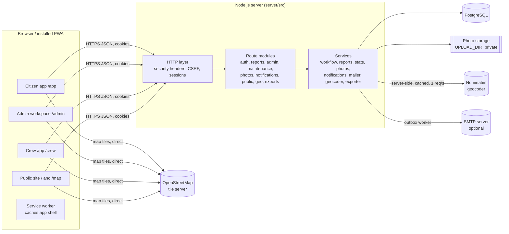

# 2. Architecture

## 2.1 Overview

Wayguard is one Node.js application that serves both the JSON API (`/api/*`)
and the built web client (everything else). The same React code base runs as
the administrator dashboard on desktops and as an installable mobile app
(Progressive Web App) for citizens and road crews.



## 2.2 Components

| Part | Responsibility | Key files |
| --- | --- | --- |
| HTTP layer | Router with `:param` paths, Koa-style middleware, JSON/multipart parsing with size limits, JSON error format, static files with SPA fallback | `server/src/lib/http.js`, `lib/static.js`, `app.js` |
| Security | scrypt passwords, session tokens, rate limiting, CSP and security headers, CSRF check | `lib/security.js`, `services/sessions.js`, `middleware/auth.js` |
| Validation | zod schemas for every request body and query | `lib/validation.js`, route files |
| Workflow | The only place statuses change: allowed transitions, roles, history entries, notifications, one transaction with a row lock | `services/workflow.js` |
| Reports | Creation, duplicate scoring, permission checks, role-specific shapes | `services/reports.js`, `routes/reports.js` |
| Photos | Sniff → decode → resize → re-encode JPEG (metadata removed) → random file name outside the web root; served only through an access-checked endpoint | `services/photos.js`, `routes/photos.js` |
| Notifications | In-app rows written in the same transaction; optional e-mail outbox with retries | `services/notifications.js`, `services/mailer.js`, `services/smtp.js` |
| Geocoder | Nominatim proxy with identifying User-Agent, contact e-mail, 1 request/second, 30-day cache | `services/geocoder.js`, `routes/geo.js` |
| Statistics and exports | Live SQL aggregates; CSV and PDF generation | `services/stats.js`, `services/exporter.js`, `routes/exports.js` |
| Web client | React 19 SPA, small history router, auth context, Leaflet map component, design tokens | `client/src/**` |
| PWA | Web manifest, generated service worker that precaches the shell and static assets but never API data or map tiles | `client/public/manifest.webmanifest`, `client/public/sw.template.js`, `client/build.mjs` |

## 2.3 Request flow: submitting a report

```mermaid
sequenceDiagram
  participant B as Citizen browser
  participant API as /api/reports
  participant P as Photo service
  participant DB as PostgreSQL
  B->>B: compress photos (canvas, max 1600 px)
  B->>API: POST multipart (fields + photos), session cookie, X-Wayguard-CSRF
  API->>API: role = citizen? rate limit? validate fields (zod)
  API->>DB: same reporter, open report within 25 m in 24 h? → 409
  API->>P: sniff type, decode, re-encode, strip metadata, write files
  API->>DB: BEGIN; insert report, photos, history event; score duplicates; notify admins; COMMIT
  alt transaction fails
    API->>P: delete written files
  end
  API-->>B: 201 {code, possible_duplicates}
```

## 2.4 Authentication and authorization

- **Passwords**: scrypt (N=2^15, r=8, p=3 — OWASP recommended parameters) with a
  random salt, compared in constant time. Unknown e-mails are checked against
  a dummy hash so timing does not reveal which accounts exist.
- **Sessions**: a random 256-bit token in an `HttpOnly`, `SameSite=Lax` cookie
  (`Secure` and `__Host-` prefixed when served over HTTPS/production). Only the
  SHA-256 of the token is stored. Sessions slide for 7 days and are revoked on
  logout, password change (other devices), password reset, role change and
  deactivation.
- **Roles**: `citizen`, `admin`, `maintenance`. Public registration always
  creates a citizen. Staff accounts are created by administrators with a
  temporary password that must be changed at first sign-in. The first
  administrator is created with `npm run create-admin`; no default admin
  password exists.
- **Authorization is enforced on the server** for every route
  (`requireRole`), and for object access: citizens see only their own reports
  and photos; crews only reports assigned (now or earlier) to their team, and
  can act only on active assignments; other users' report IDs answer 404 so
  IDs cannot be probed. Hiding buttons in the UI is never the only protection.
- **CSRF**: state-changing requests must send `X-Wayguard-CSRF: 1` (a custom
  header cannot be sent cross-site without a CORS pre-flight, and CORS is not
  enabled) and, when present, the `Origin` must match the host.
- **Rate limits** (per process): sign-in (30 per IP / 8 per account per 15
  min), registration, report submission (10 per hour per user), password
  changes, address lookups and exports.

## 2.5 Security headers and privacy

Content-Security-Policy (`default-src 'self'`, images only from self and the
configured tile host, no inline scripts, no framing), `X-Content-Type-Options`,
`X-Frame-Options: DENY`, `Referrer-Policy: strict-origin-when-cross-origin`
(the OSM tile policy needs a referrer), `Permissions-Policy` limiting
geolocation and camera to the site, HSTS when HTTPS is used.

Privacy measures: data minimisation (only name, e-mail, optional phone), EXIF
and GPS metadata stripped from photos, public endpoints return verified
reports without reporter identity or photos, exports omit personal details,
the geocoder receives only search text or coordinates.

## 2.6 Mapping

- **Default — Wayguard road map**: MapLibre GL JS 5 (CSP build, worker served
  from `/vendor/`, loaded on demand as a separate chunk) drawing OpenMapTiles
  vector tiles from OpenFreeMap with the custom "Wayguard Road" style
  (`components/roadStyle.js`: Cloud land, white streets, Road Amber main roads,
  Navy labels, few icons — the look of driving apps such as Waze, in Wayguard's
  palette). `components/VectorMap.jsx`.
- **Day / night**: `PALETTES.night` (default, Night Ink land, slate streets,
  Road Amber main roads, white route-number shields drawn at runtime) and
  `PALETTES.day`; the choice is kept in `localStorage` (`lib/mapTheme.js`).
  Google Maps uses its own dark colour scheme at night; the raster fallback
  darkens tiles with a CSS filter.
- **Drive mode** (in the map screen): `watchPosition` → heading (GPS heading,
  or computed from movement) and speed; the engine's `follow()` keeps you in
  view heading-up and tilted; the you-are-here puck becomes an amber arrow;
  the nearest open report within 500 m and ±40° of your heading raises a
  "Pothole ahead" banner. Dragging the map pauses following (Recenter
  resumes); short GPS errors do not end drive mode, a denied permission does.
- **Map screen** (`components/MapScreen.jsx`): the public map, the citizen map
  and the crew task map fill the screen. Floating search (reports, and places
  for signed-in users), filter chips, round buttons (locate me with a
  you-are-here puck, 3D tilt on the vector map, zoom), a big Report button
  that asks *where* (GPS or map centre) and *how bad*, then opens the report
  form pre-filled (`/app/report?lat=&lng=&src=&acc=&severity=`), and a bottom
  sheet for details or the full list (the text alternative to the map).
  Engines expose the same small handle (`mapApi`: flyTo, getCenter,
  setUserLocation, set3d, zoomBy).
- **Other providers**: Google Maps (Maps JavaScript API with Advanced Markers,
  `client/src/components/GoogleMap.jsx`, loaded by `client/src/lib/googleMaps.js`)
  when `GOOGLE_MAPS_API_KEY` is set; Leaflet 1.9 with OpenStreetMap raster
  tiles for `MAP_PROVIDER=osm`. `MapView.jsx` picks the provider from
  `/api/public/config` and falls back to Leaflet for the rest of the session if
  the chosen one fails (no WebGL, tiles unreachable, Google auth failure, script
  blocked, time-out). All engines take the same props and draw the same report
  bubbles (`mapPins.js`).
- **Library (OpenStreetMap)**: Leaflet 1.9 (`client/src/components/MapView.jsx`).
- **Tiles**: configurable `TILE_URL` (default `https://tile.openstreetmap.org/{z}/{x}/{y}.png`)
  and `TILE_ATTRIBUTION`, shown on every map. The service worker never caches
  tiles and nothing prefetches them, per the OSM Foundation tile usage policy.
  The public OSM server is for light use; for production traffic use a
  commercial or self-hosted OSM-compatible tile service (only `.env` changes).
- **Coordinates**: stored as `DOUBLE PRECISION` latitude/longitude with range
  checks in both the database and the API; GPS accuracy stored when known.
- **Markers**: report bubbles with a pothole symbol, showing severity by colour
  **and** a letter tag (H/M/L); repaired reports are white with a check mark,
  work awaiting LGU checking shows an hourglass; the selected bubble enlarges
  with an amber outline.
  Markers are keyboard-focusable and every map page also has a text list.
- **Geocoding**: Nominatim (default) or, with `GEOCODER_PROVIDER=google`, the
  Google Geocoding API with a server-only key; always through the server (identifying User-Agent,
  contact e-mail, max 1 request/second, results cached 30 days, biased to the
  LGU area and country). If it fails, people are told to pin the map instead.
- **GPS**: requested only when the person taps "Use my current location";
  map rendering and GPS acquisition are independent.

## 2.7 Notifications

Each workflow action writes notification rows inside its transaction, so a
notification exists if and only if the change was committed. Recipients:
reporter (every status change, public LGU notes), team members (new task,
reassignment, completion returned/approved), administrators (new report,
completion submitted, feedback). The web client polls the unread count every
60 s and on focus. When `SMTP_HOST` is set, rows for users who allow e-mail
are marked `pending` and a worker sends them every 15 s (3 attempts).

## 2.8 Decisions and assumptions

| Decision | Reason |
| --- | --- |
| One responsive PWA instead of a separate native app | The brief lists a PWA as a practical mobile option; one code base for web and mobile, installable, camera and GPS available in the browser |
| Node.js built-in `http` with a ~250-line router instead of Express | The development sandbox had no access to the npm registry, so only packages already available offline could be used. The route modules follow the usual Express structure and can be moved to Express if wanted |
| `postgres` (Postgres.js) driver instead of `pg` | Zero dependencies (installable in the sandbox); tagged-template queries always use bound parameters |
| Server-side sessions instead of JWT | Same-origin web app; immediate revocation on role change or deactivation |
| esbuild instead of Vite | Available offline; a 100-line build script produces hashed assets and the service worker |
| Keep the eight recommended statuses; mark "repair done, awaiting check" with `work_completed_at` | Matches the brief's status list exactly while supporting crew completion → admin verification |
| Agencies and teams as data | Constraint 5 (responsible agency); teams carry assignments, crew members belong to one team |
| Duplicate detection without PostGIS | Haversine SQL function + bounding-box pre-filter; no database extension needed on student machines |
| Self-hosted fonts | Brand fonts work offline and without Google Fonts requests |
| Demo data clearly labelled | Prompt rule: never present fabricated data as real; `is_demo` flag, "Demo" tags, "DEMO PHOTO" stamped illustrations |
| Timezone `Asia/Manila` for monthly statistics | LGU context; configurable with `APP_TIMEZONE` |

Assumptions made where the brief is silent: at least one photo is required
per report (brief: reports include photos); public map shows verified,
assigned, in-progress and recently resolved (default 90 days) reports;
administrators may also start work on behalf of a crew; resolved reports are
final.
