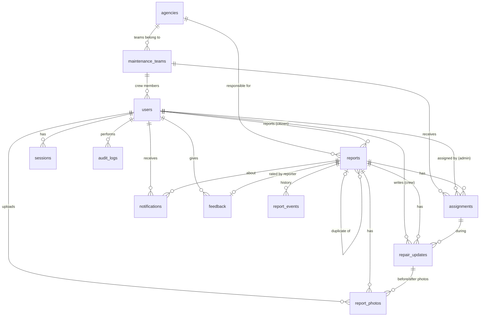

# 3. Database

PostgreSQL 14+ (tested with 16). The initial schema is `server/src/db/migrations/001_initial_schema.sql`; `002_multi_lgu.sql` adds multi-LGU tenancy. Migrations run with `npm run db:migrate` (each file runs once in a transaction and is recorded in `schema_migrations`). Existing records are attached to the first LGU created from the installation's current `lgu_name` setting.

The `lgus` table stores a workspace for each city or municipality. LGU-owned users, agencies, maintenance teams, reports, assignments, settings and audit entries carry an `lgu_id`. Composite foreign keys prevent a team, assigned user, responsible agency, reporter or duplicate link from crossing LGU boundaries. `platform_admin` accounts are the only users without an `lgu_id`; they provision tenants, but do not receive ordinary LGU report-management access.

## 3.1 Entity–relationship diagram

## 3.2 Tables

### users
| Column | Type | Notes |
| --- | --- | --- |
| id | serial PK | |
| email | text | unique on `lower(email)` |
| password_hash | text | `scrypt$N$r$p$salt$hash` |
| full_name | text | 2–100 chars |
| phone | text, null | |
| role | text | `citizen`, `admin`, `staff`, `maintenance`, `platform_admin` |
| lgu_id | int → lgus, null only for `platform_admin` | Tenant boundary for every non-platform account |
| team_id | int → maintenance_teams, null | only allowed for maintenance (CHECK); team must belong to the same LGU |
| is_active | bool | deactivated users cannot sign in |
| email_notifications | bool | user preference |
| must_change_password | bool | set for admin-created/reset passwords |
| last_login_at, created_at, updated_at | timestamptz | |

### sessions
`id` (SHA-256 of the cookie token, PK), `user_id` → users (cascade),
`created_at`, `last_seen_at`, `expires_at`, `ip`, `user_agent`. Expired rows
are purged hourly.

### agencies
`id`, `name` (unique, case-insensitive), `jurisdiction` (`national`,
`provincial`, `city_municipal`, `barangay`, `other`), `contact_email`,
`contact_phone`, `is_active`, `created_at`.

### maintenance_teams
`id`, `name` (unique, case-insensitive), `agency_id` → agencies (set null),
`description`, `is_active`, `created_at`. A team with active assignments
cannot be deactivated.

### reports
| Column | Type | Notes |
| --- | --- | --- |
| id | serial PK | |
| code | text unique | `WG-YYYY-NNNNN` from `report_code_seq` |
| reporter_id | int → users | RESTRICT (reports are kept) |
| description | text | 10–2000 chars |
| road_name | text | 2–150 chars |
| barangay, city, landmark | text, null | |
| hazards | text[] | from a fixed list |
| road_type | text | `national`, `provincial`, `city_municipal`, `barangay`, `private`, `unknown` |
| reported_severity / severity | text | `low`, `medium`, `high`; reporter's value kept, confirmed value used |
| status | text | 8 statuses (CHECK) |
| latitude / longitude | double precision | CHECK −90..90 / −180..180 |
| location_source | text | `gps`, `map`, `address` |
| location_accuracy_m | real, null | GPS accuracy |
| agency_id | int → agencies, null | responsible agency |
| duplicate_of_id | int → reports, null | required when status = duplicate; not self |
| rejection_reason | text, null | required when status = rejected |
| work_completed_at | timestamptz, null | crew submitted completion; only while in progress/resolved |
| verified_at, resolved_at | timestamptz | resolved_at required when resolved |
| is_demo | bool | seed data marker |
| created_at, updated_at | timestamptz | |

Indexes: status; (reporter_id, created_at); created_at; (latitude, longitude);
severity; lower(barangay).

### assignments
`id`, `report_id` → reports (cascade), `team_id` → maintenance_teams
(restrict), `assigned_by` → users, `instructions`, `due_date` (date),
`is_active`, `assigned_at`, `ended_at`, `end_reason` (`reassigned`,
`unassigned`, `completed`). Partial unique index: **one active assignment per
report**. CHECK keeps `is_active`/`ended_at` consistent.

### repair_updates
`id`, `report_id`, `assignment_id`, `author_id`, `update_type` (`progress`,
`completion`), `note` (3–2000), `created_at`.

### report_photos
`id`, `report_id` (cascade), `uploaded_by`, `kind` (`report`, `before`,
`progress`, `after`), `repair_update_id`, `storage_key` (unique random path),
`mime_type`, `width`, `height`, `size_bytes`, `created_at`. Files live in
`UPLOAD_DIR/<key>.jpg` and `<key>_thumb.jpg`.

### report_events (history)
`id`, `report_id` (cascade), `actor_id` (set null), `event_type`
(`created`, `status_changed`, `severity_changed`, `agency_set`, `reassigned`,
`repair_progress`, `repair_completed`, `completion_returned`,
`duplicate_flagged`, `duplicate_linked`, `internal_note`, `public_note`,
`details_updated`, `feedback`), `from_status`, `to_status`, `message`,
`is_public` (visible to the reporter), `meta` (jsonb), `created_at`.

### notifications
`id`, `user_id` (cascade), `report_id`, `type`, `title`, `body`, `read_at`,
`email_status` (`pending`, `sent`, `failed`, `skipped`), `email_attempts`,
`created_at`. Indexes for the user's list, unread count and the e-mail outbox.

### feedback
`id`, `report_id` (unique — one per report), `user_id`, `rating` (1–5),
`comment` (≤1000), `created_at`.

### settings
Key/value (jsonb): `lgu_name`, `duplicate_radius_m` (30),
`duplicate_window_days` (90), `max_photos_per_report` (5), `map_center`,
`road_type_agency`, `public_resolved_days` (90).

### audit_logs
`id`, `actor_id`, `action` (e.g. `user.update`, `settings.update`,
`export.csv`), `target_type`, `target_id`, `details` (jsonb, before/after
values), `ip`, `created_at`.

### geocode_cache
`query_key` (SHA-256 of the query), `response` (jsonb), `created_at`.

## 3.3 Function

`wg_distance_m(lat1, lng1, lat2, lng2)` — haversine great-circle distance in
metres (IMMUTABLE), used for duplicate detection with a bounding-box
pre-filter on the `(latitude, longitude)` index.

## 3.4 Integrity rules

- Status rules are enforced twice: the workflow service allows only listed
  transitions, and CHECK constraints reject impossible rows (duplicate without
  original, rejected without reason, resolved without time, completion flag
  outside in-progress).
- All workflow actions lock the report row (`SELECT … FOR UPDATE`) inside a
  transaction, so two administrators cannot act on the same report at once.
- Photo files written before a failed transaction are deleted.

## 3.5 Retention and deletion

- Reports, photos and history are kept for the LGU's records; there is no
  delete action in the app (accounts are deactivated, not deleted, so their
  reports remain).
- Resolved reports leave the public map after `public_resolved_days`.
- Sessions expire after `SESSION_TTL_DAYS` and are purged hourly.
- Geocoder cache entries are refreshed after 30 days.
- Demo data can be removed with `npm run db:seed -- --fresh` (development only).
